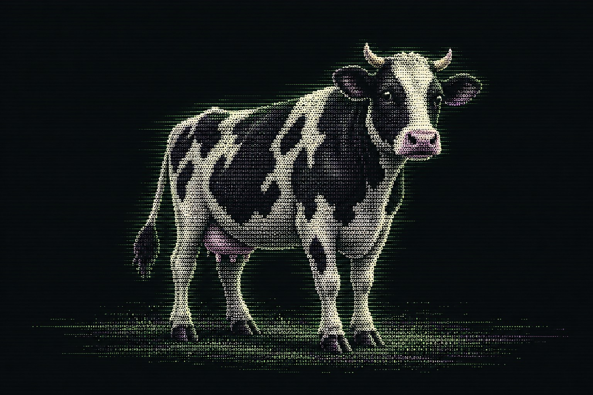
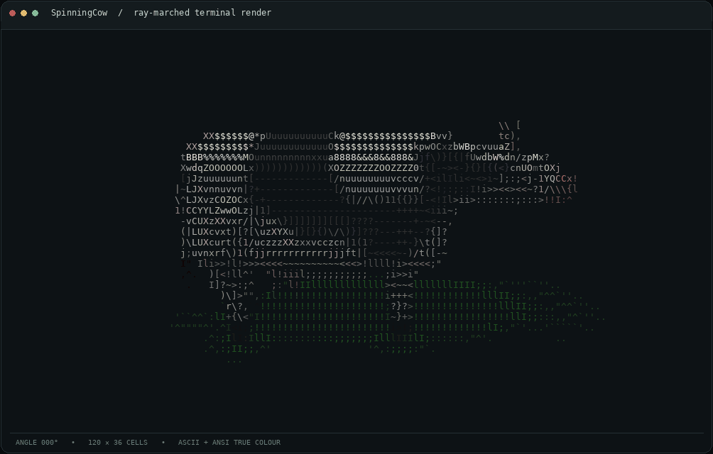
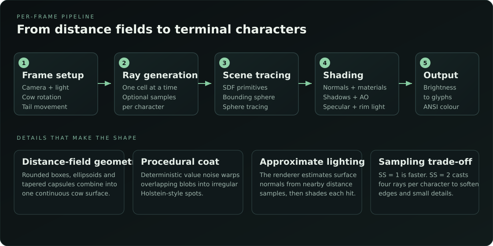

<h1 align="center">
  <br/>
  SpinningCow
</h1>

<p align="center">
  <em>A 3D Holstein cow, rendered one terminal character at a time.</em>
</p>

<p align="center">
  
  
  
  
</p>

<p align="center">
  
</p>

> SpinningCow builds its cow from mathematical distance functions instead of storing a mesh or plotting a cloud of points. The renderer sends rays through the character grid, finds the surface, shades it, and turns its brightness into text.

---

## 🐄 The idea

Most terminal graphics cheat a little: they place characters at hand-picked positions or project points onto the screen. SpinningCow takes the longer route. The cow exists as a three-dimensional **signed distance field** (SDF), a function that estimates how far a point is from the nearest surface.

Each character cell gets one or more rays. A ray advances through the scene until it reaches the cow or the ground. The hit point is lit using surface normals, diffuse and specular light, ambient occlusion, and soft shadows. Finally, brightness chooses a character from a density ramp. The result is a rotating cow that is actually rendered from a 3D scene, rather than a prewritten block of ASCII art.

## 🎞️ See it run

<p align="center">
  
</p>

The animation above is rendered by the Java program. The separate hero image is project artwork, not a screenshot of the renderer.

---

## ⚙️ How it works

<p align="center">
  
</p>

### 1. Build the scene from distance functions

`map(x, y, z)` combines simple shapes into the cow. Rounded boxes form the body, ellipsoids add volume, and tapered capsules make the legs, neck, horns, and tail. A smooth-minimum operation blends nearby shapes instead of leaving every joint looking like two objects glued together.

### 2. Trace rays through the scene

`trace(...)` maps a terminal coordinate to a ray direction. Before doing the expensive work, it tests the ray against a bounding sphere around the cow. Rays that miss that sphere skip the cow entirely. Rays that enter it use **sphere tracing**: each step advances by a fraction of the distance returned by `map(...)`, stopping when it gets close enough to the surface.

### 3. Shade the surface

At a hit, the renderer estimates a normal from four nearby distance samples. It combines direct light, specular highlights, rim light, ambient occlusion, and soft shadows to calculate brightness. The coat's dark patches come from deterministic value noise and overlapping blobs, so the spots have irregular edges without any texture files.

### 4. Convert brightness into text

The `RAMP` string runs from sparse characters to dense ones. The final brightness selects a position in that string. With colour enabled, the renderer also writes 24-bit ANSI foreground colours. Supersampling averages several ray results for each character, softening the edges.

---

## 🚀 Getting started

### Requirements

- **Java 9 or newer** (the source uses `InputStream.readAllBytes()`).
- A terminal that supports ANSI escape sequences for screen updates and colour output. A modern Windows Terminal, Linux terminal, macOS terminal, or compatible IDE terminal should work.
- No external Java dependencies.

### Compile and run

Place `SpinningCow.java` in a directory, open a terminal there, and compile it:

```bash
javac SpinningCow.java
```

Start the animation:

```bash
java SpinningCow
```

To set the frame size explicitly, which is useful in IDE consoles or terminals that report their dimensions incorrectly:

```bash
java SpinningCow -w 100 -h 30 -s 1
```

A still frame is useful when debugging the renderer or capturing output:

```bash
java SpinningCow --still -w 120 -h 36 -s 2 --angle 24
```

Enable colour:

```bash
java SpinningCow -w 120 -h 36 -s 1 -c
```

Measure the average render time over 100 frames:

```bash
java SpinningCow --bench 100 -w 120 -h 36 -s 1
```

---

## 🧰 Command-line options

| Option | Description |
|---|---|
| `-w N` | Frame width in terminal columns. |
| `-h N` | Frame height in terminal rows. |
| `-s N` | Samples per axis inside each character cell. `1` is faster; `2` casts four rays per cell. |
| `-c` | Enable 24-bit ANSI colour output. |
| `--noground` | Disable the ground shadow. |
| `--still` | Render one frame and exit. |
| `--angle D` | Set the cow's angle in degrees for `--still`. |
| `--bench N` | Render `N` frames and print the average frame time. |

All options are optional. If the width or height is omitted, SpinningCow attempts to detect the terminal dimensions. On Unix-like systems it uses `stty`; on Windows it queries PowerShell. If detection fails, the fallback size is `100 × 30`. One row and one column are left unused when terminal dimensions are detected, to reduce unwanted wrapping and scrolling.

## ⚡ Quality and performance

Rendering cost depends mainly on the frame size and sampling rate.

- **Use `-s 1` for speed.** Each character gets one ray sample.
- **Use `-s 2` for smoother edges.** Each character gets four samples. Sampling cost grows with the square of `N`, so `-s 3` means nine samples per character, not three.
- **Reduce `-w` and `-h`** if your terminal is small or rendering is slow.
- **Use `--still` or `--bench`** when you want a reproducible frame or a basic timing measurement instead of running the animation indefinitely.

The renderer processes rows in parallel. Frame-level camera, light, and animation values are prepared before rendering begins; worker threads then read those values and write to their own character-cell positions.

## 🧩 Implementation notes

SpinningCow is intentionally a single Java source file. Its main components are:

| Method | Responsibility |
|---|---|
| `sdEllipsoid`, `sdRoundBox`, `sdTaper` | Distance functions for the basic shapes. |
| `smin` | Smoothly blends distance fields into a continuous model. |
| `map` | Combines the body, head, legs, udder, horns, and tail. |
| `spotCoverage` | Generates the coat pattern from procedural noise and blobs. |
| `trace` | Builds a ray, skips the bounding sphere when possible, and finds the nearest hit. |
| `shadeCow`, `softShadow`, `shadeGround` | Calculates surface lighting and the ground shadow. |
| `render` | Parallelises the frame and averages supersamples. |
| `frame` | Maps brightness to glyphs and assembles the terminal output. |
| `setupFrame` | Updates camera position, light direction, rotation, and tail sway for a frame. |

## 📌 Limitations

- The output is constrained by terminal character cells, so its appearance depends on the terminal font and aspect ratio.
- Automatic sizing is performed at startup. Restart the program after resizing the terminal to use the new dimensions.
- Colour and cursor control depend on ANSI terminal support. Redirected output and some IDE consoles may not behave like a real terminal.
- The model and lighting are hand-tuned approximations, not a general-purpose 3D engine.

## 📄 License

No license has been declared in this repository yet. Add a `LICENSE` file before treating the project as licensed for reuse or redistribution.
